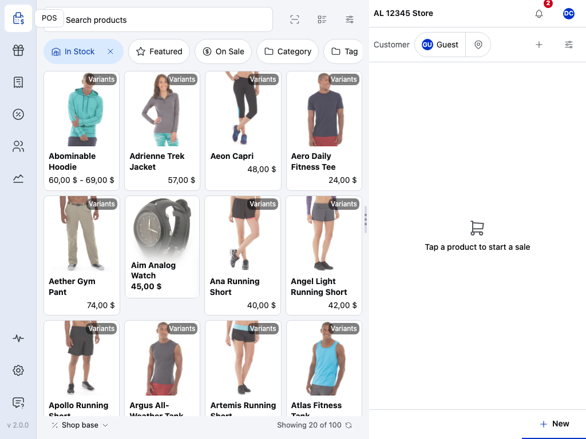
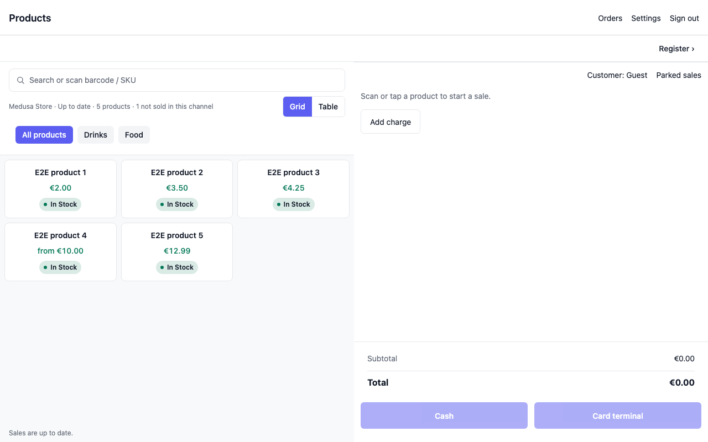
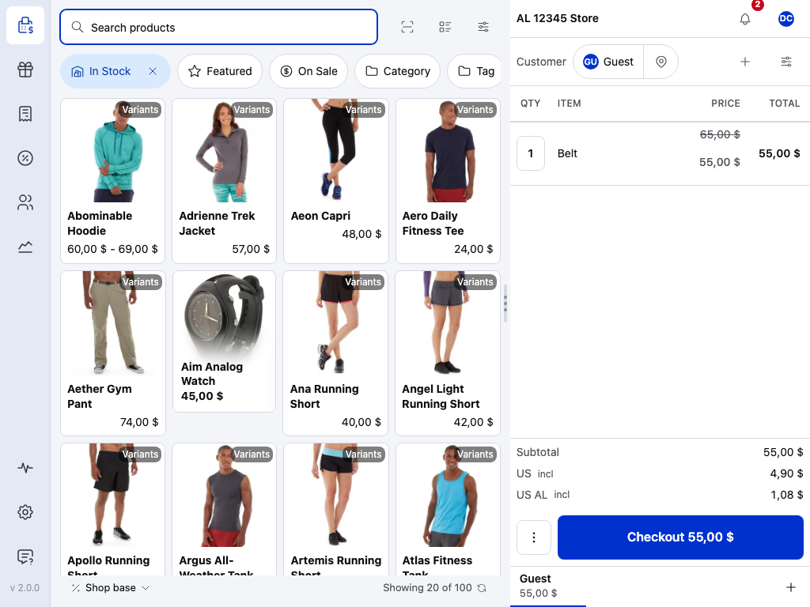
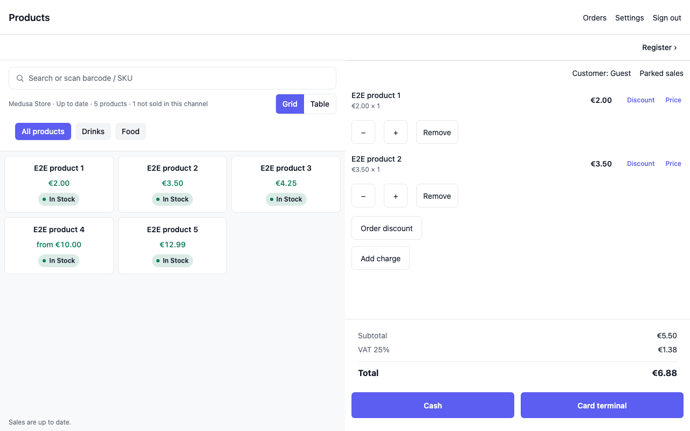
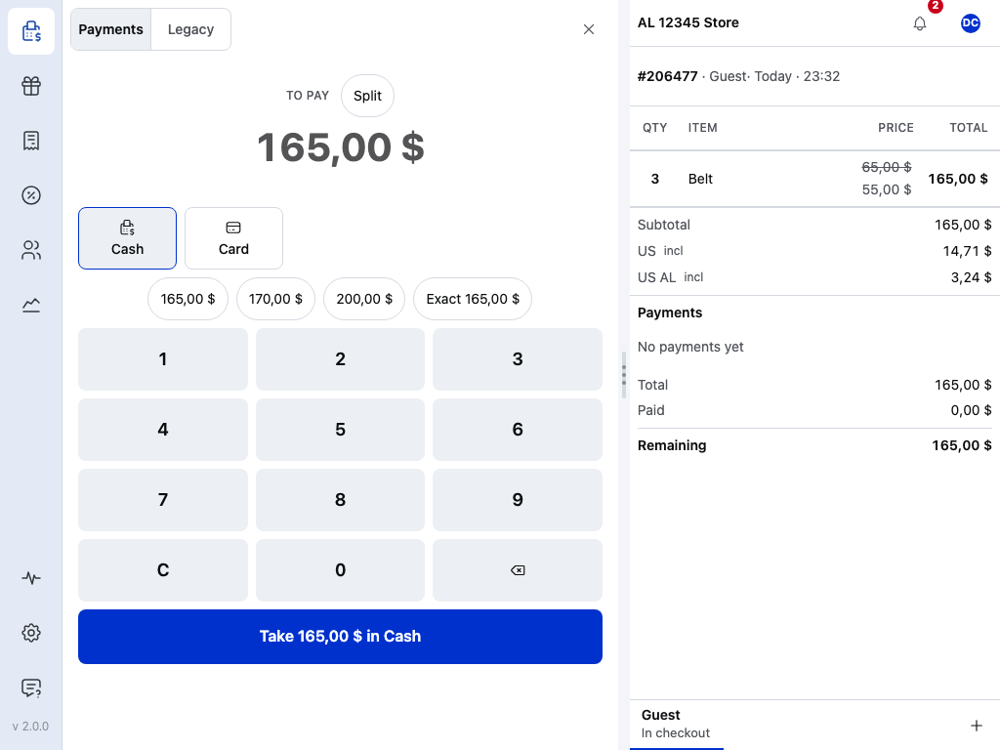
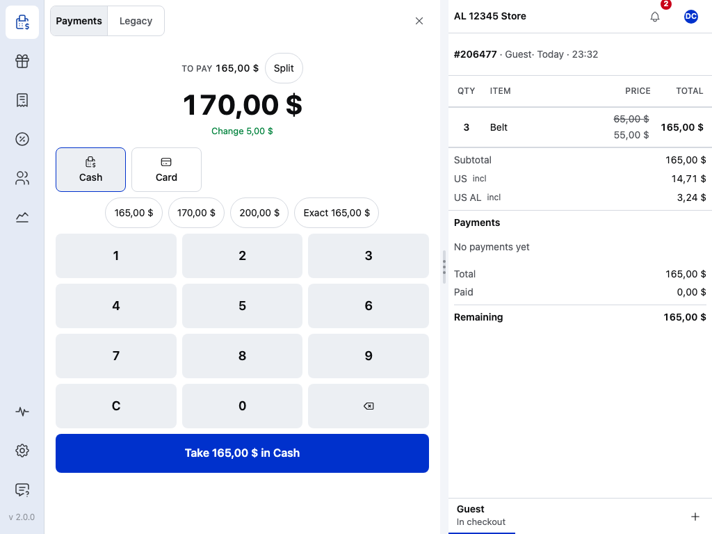
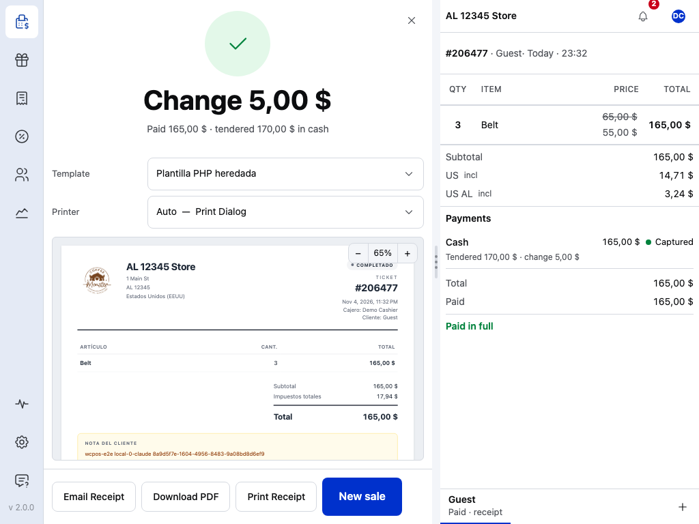
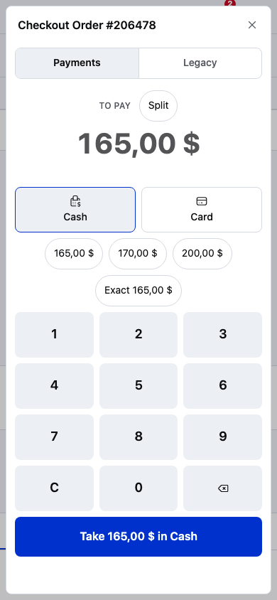

# WCPOS v2 parity audit: MedusaPOS

Read on 2026-11-10; the status of rows 2, 4, 5, 11, 13, 15, 17, 18, 25, 28, 31 and 33 was refreshed on 2026-11-18 against `main` at `ee680a4`, and rows 7 and 9 on 2026-11-18 at `bc4570a`, with the PR that landed each piece. The other rows are still as read on 2026-11-10; `DEMO-PARITY.md` is the current screen-by-screen rating.
- **Target:** WCPOS 2.0.0, `~/Projects/monorepo` `main` at `5ac185b` (`apps/main` 2.0.0). Paths below are under `packages/core/src/` unless they start with `apps/` or `packages/`; `scr/` is `screens/main/`.
- **This app:** medusapos `main` at `8489e99`: app 0.2.0, plugin 0.3.0 (`packages/medusa-plugin`), `@tallyui/*` 3.8.0 pinned in `apps/expo/package.json`.

Each row is a feature a merchant expects, built Medusa's way (Paul, 2026-10-07): v2 sets which features and the taste, not the mechanism. `docs/V2-PARITY.md` stays the per-feature ledger with e2e evidence; this file is the v2 gap map and the work split.

**Status:** Has, Partial, Missing, N/A. **Gap owner:** **app** = `apps/expo` alone; **TU** = needs a shared TallyUI package, naming the package and the function; **plugin** = backend work in `packages/medusa-plugin`. **Build now** = app or plugin work that does not wait on TU.

## Areas

| # | v2 area (monorepo paths) | Status here | Evidence in this app | Gap and owner | Build now |
|---|---|---|---|---|---|
| 1 | Redrawn UI, Settings › Theme: 10 themes, **Scale** (Auto, Compact, Regular, Spacious), Icons, **Fonts** (System, DM Sans · Instrument Serif, Space Grotesk, DM Sans · Fraunces, Manrope) (`scr/settings/theme.tsx`, `contexts/scale`, `contexts/theme-setting`, `packages/components`) | Missing | Light only: `apps/expo/app/_layout.tsx` `Uniwind.setTheme('light')`; TU `theme` exports `cn` and `tokens.css` (has a `dark` variant) | **TU** `@tallyui/theme`: scale tokens + `ScaleProvider`, font families, theme presets; `@tallyui/components` redrawn kit. **app**: Settings › Theme section | System/Light/Dark switch on TU's dark tokens (U5) |
| 2 | Register screen layout: resizable columns, phone tabs, filter chips (`apps/main/app/(app)/(drawer)/(pos)`, `packages/resizable-panels`) | Partial | Phone below 600 px has v2's Products / Cart bottom tab bar (#345) with the "New" badge (#369) and v2's header (#368); the nav rail and phone drawer (#300); category filter chips on Products (#409). Columns are still fixed | **TU** `@tallyui/components`: resizable split; filter pills beside search | — |
| 3 | Product browse: grid/table, variant drill-in, stock pill, "from" price, grid columns, tile fields, filter pills (`scr/pos/products`) | Partial | TU `Catalogue` grid/table + category nav (`apps/expo/lib/catalogue-view.ts`); variant chooser (ADR 0007) | **TU** `@tallyui/components` `Catalogue`: drill-in, stock pill, tile-field and column settings, tag/brand filter pills | — |
| 4 | Open orders as tabs (`scr/pos/cart/tabs.tsx`) | Has | Open sales are cart tabs (`OpenSaleTabs`) (#315), with Cart Settings' open-orders position (#332); "+" starts a new sale and parks the current one (`docs/v2-parity/DEMO-PARITY.md` row 08) | Tab age ("6 h") and the overflow count chip: **TU** `@tallyui/components` `OpenSaleTabs` | — |
| 5 | Cart editing: keypad qty, tap-to-edit, swipe, line sort (`scr/pos/cart/table.tsx`) | Partial | Tap qty or price opens a keypad popover on the line (#299), with quick-discount keys (#319, #352); Cart Settings drives columns (#360) and "Sort items" (#400, display order only) | Swipe on a line is not built: **TU** `@tallyui/components` `Cart` | — |
| 6 | Add menu: misc product, fee, shipping, quick discount (`scr/pos/cart/add-*.tsx`) | Has | `order.create` v5 (`docs/adr/0021`), `e2e/charges.spec.ts`, `e2e/discount.spec.ts` | Quick-discount keys setting: **TU** | — |
| 7 | Coupons in cart (`scr/pos/cart/add-coupon*.tsx`) | Has | Medusa promotion codes, priced and applied by the store (ADR 0025; plugin #302, app #303): a "Coupon code" field under Subtotal and an "Add Coupon" row in the cart "+" menu (#420) (`apps/expo/components/coupon-field.tsx`, `e2e/coupons.spec.ts`) | Picking a code from a list of the store's coupons, as v2's Add Discount › Coupon tab does: **app**, **plugin** | — |
| 8 | Order sheet: note, meta, void, print, sync (`scr/pos/cart/order-sheet.tsx`) | Partial | Note done: the cart's `CartNoteInput`, order.create v7, and the store's `metadata.tally_note` (ADR 0024, `e2e/order-note.spec.ts`). Meta, void, print and sync from the order sheet are not done | Order meta, void, print and sync from the sheet: **TU** order sheet; **app** wiring | — |
| 9 | Customer in cart: search, guest, create (`scr/pos/cart/add-customer.tsx`) | Has | TU `CustomerPicker` behind v2's avatar chip with a map-pin address button (#421, #424); "Add new customer" in the cart "+" menu (#406); default customer under Settings › General (#336, #423); `e2e/customers.spec.ts` | A search list dropped from the chip with a Guest row, where ours is a centred modal: **TU** `@tallyui/components` `CustomerPicker` | — |
| 10 | Totals and tax display, itemized/single (`scr/pos/cart/totals.tsx`) | Has | `Cart` `taxLabel`; region tax-inclusive prices | — | — |
| 11 | Tender pane: tiles, keypad, quick amounts, split ledger, change, void legs, cash rounding (`scr/pos/checkout/tender`) | Partial | TU 3.16 tender pane (#283): total, Cash / Card terminal tiles, Exact and note keys, keypad, "Take €x in Cash"; wide tender beside the order summary (#351); phone "Checkout Order" (#335); split ledger with Cancel payment (`e2e/split-tender.spec.ts`). Card is `external` only | Change as the headline, a Split 2–5 pill, cash rounding: **TU** `@tallyui/components` `Tender`, `@tallyui/pos` | — |
| 12 | Offline cash sales and outbox (`scr/pos/checkout/commit-sale.ts`, `packages/sync-core`) | Has | `apps/expo/lib/outbox-context.tsx`, SQLite-wasm; `e2e/offline.spec.ts`, `e2e/outbox.spec.ts` | — | — |
| 13 | Receipt stage: print & new sale, no receipt, auto-print, drawer kick (`scr/pos/checkout/receipt-stage`) | Partial | Paid screen with the order summary and payments (#359), v2's tick and change (#373); Print, Email receipt (#314), New sale; "Automatically show receipt after checkout" (#379) and auto-print (#370); Orders reprint (#395); on web, drawer kick once per cash sale on an Epson or Star network printer (`e2e/cash-drawer.spec.ts`, 2026-11-25) | Download PDF: **TU** (printing); drawer kick on native: **TU** | — |
| 14 | Registers: float, pay in/out with reasons, no sale (`scr/pos/cart/register-*.tsx`, `services/register`) | Has | `apps/expo/components/register.tsx`; `e2e/register.spec.ts` | No-sale: done 2026-11-25, TallyUI 4.1.0 `RegisterPanel`/`MovementSheet`, proved in `e2e/register.spec.ts` | — |
| 15 | Count at close, numbered closures, Z print, X report, handover (`services/register-session`, `scr/components/register-count`) | Has | Z print from the closure sheet and Last closure (#270); X report print from Reports (#276) and the register side sheet (#328); numbered closures (#284); hand-over in the user sheet (#322); "n carts still open" warning (#407); the product side locks while counting (#350) | Closure sheet look (large variance, cash breakdown): **TU** `@tallyui/components` `ClosureSheet` | — |
| 16 | Manager approval over a threshold (`scr/pos/cart/approve-sheet.tsx`) | Partial | Plugin 0.3.0 verifies a proof (`POST /tally/v1/register-approvals`, contract 3, #254); the till still sends v2 commands with a second login (`apps/expo/lib/approval.ts`) | **TU** `@tallyui/pos` `register-commands`: a contract-3 `closure.submit` carrying `approval`; then **app** obtains the proof | — (needs TU) |
| 17 | Reports: sales cards, closures history with recount, CSV, print (`scr/reports`) | Has | Reports (#275) with TU's Sales room (#316): sales cards, Print summary (#372), CSV; closures as table rows grouped by day, a row opens the closure (#334, #355), with period, register and cashier filters (#366); earlier closures from `GET /tally/v1/registers/:id/closures` (#272, #277); register strip (#353) | Chart by hour and a refunds count (no refund flow): **TU** `@tallyui/pos` `salesFigures`, `@tallyui/components` `SalesHero` | — |
| 18 | Orders screen: list, view, reopen, receipt, refund (`scr/orders`) | Partial | `apps/expo/app/orders.tsx`: v2's table (#520) of the store's orders through TU connector-medusa `listOrders` and the plugin's `GET /tally/v1/orders` (#556), under this till's unsent sales, with Search Orders and the filter pills the connector supports; a row opens TU `OrderDetail` in a right-hand sheet (#356) with Receipt reprint (#395) and Sync for an unsent sale (#403); an order only the store has opens read-only. Since #598 a Billing Address column (the store order's own address, read from Medusa's `GET /admin/orders`; for a till sale that is the stock location's address) and v2's day headers (Today, Yesterday, then the date) between rows; the app reads the address itself because TallyUI's `StoreOrder` has none (`TU core`, `TU connector-medusa`, TallyUI#1350) | Refund, reopen: `@tallyui/pos` refund model | — (contract is TU's) |
| 19 | Refunds: per line or amount, reason, destination (`scr/orders/refund`) | Missing | No refund command | **TU** `@tallyui/pos` refund model + `refund.create` command; **plugin** command on Medusa returns/refund workflows; **app** flow from an order | — |
| 20 | Receipts screen: templates, printer switch, email with offline queue (`scr/receipt`) | Partial | On-screen receipt, browser print. TU core `Connector.emailReceipt?(ctx, orderId, email, {saveToBilling})` exists; `connector-medusa` does not implement it | **plugin** `POST /tally/v1/orders/:id/receipt-email` through Medusa's notification module; **TU** `@tallyui/connector-medusa` `emailReceipt`, `@tallyui/components` `Receipt` email action + queue | Plugin email route (U6) |
| 21 | Receipt templates (15), ESC/POS, ePOS, raster (`packages/receipt-renderer`, `packages/printer`) | Missing | One layout | **TU** renderer + printer packages | — |
| 22 | Printing settings: printers, paper, codepage, drawer kick, routing (`scr/settings/printing`) | Partial | Settings › Printing on web: Add, Edit, Delete and Test print of an Epson or Star network printer, with Open Cash Drawer and its pin; drawer kick on a cash sale and on No sale (`e2e/cash-drawer.spec.ts`, 2026-11-25) | Receipts to network printers, paper and codepage, routing, StarPRNT, USB, Bluetooth and native: **TU** printer transports | — |
| 23 | Card readers: Tap to Pay, Bluetooth, smart readers (`scr/settings/card-readers`, `services/terminal-payments`) | Missing | Card is an `external` payment | **TU** `@tallyui/pos` payment-transport interface; **plugin** route to the store's Medusa payment providers (Stripe Terminal) | — |
| 24 | Customer display: pairing, live mirror (`services/customer-display`) | Missing | — | **TU** display component + peer channel; **plugin** pairing endpoint | — |
| 25 | Barcode: wedge, HID, BLE, camera, sounds, test panel (`packages/scanner`, `scr/settings/barcode-scanning`) | Partial | Wedge + min length + test field (`apps/expo/lib/use-wedge-scan.ts`, `e2e/settings.spec.ts`); prefix, suffix and "Play a sound on scan" (#339); connect a scanner directly from Settings > Scanner (#357); camera scanning on web: a "Use camera" switch, TU 4.2.0 `Catalogue` `cameraScan` + `useCameraScan` (`e2e/camera-scan.spec.ts`) | Native camera scanning (no `expo-camera`) | — |
| 26 | Sync: status dot, sync button, refusals (`packages/sync-engine`, `scr/components/online-status`) | Has | TU `SyncStatus`, `OutboxStrip`, live stock (`/tally/v1/changes`); `e2e/strips.spec.ts`, `e2e/live-stock.spec.ts` | — | — |
| 27 | Health: database, logs, performance (`scr/health`, `scr/logs`) | Missing | Console logging + Send feedback (`apps/expo/lib/logging.ts`) | **TU** `@tallyui/pos` ring-buffer log sink + `@tallyui/components` log view; **app** route | — |
| 28 | General settings: store info, language, number format, default customer, clear local data (`scr/settings/general.tsx`) | Has | `apps/expo/app/settings.tsx` on TU `SettingsLayout` with v2's section nav (#329, #399, #405): General / Tax, read-only Store and Currency & numbers (#364), Default customer (#336, #393), Printing (#370), Card readers (#392), Scanner, Theme with Scale and Font (#333, #343), Danger zone › Clear all local data (#278) | Language / i18n: **TU** (i18n); customer display (row 15e) | — |
| 29 | Tax settings mirror (`scr/settings/tax.tsx`) | N/A | Woo setup mirror; Medusa's equivalent is the region's tax settings, shown read-only in Store (row 28) | — | in U7 |
| 30 | Products/stock/COGS editing (`scr/products`) | Missing | — | **TU** edit sheet + `connector-medusa` `updateVariantPrice`/`adjustStock`; **plugin** or admin API under RBAC | — |
| 31 | Customer management: add/edit, addresses (`scr/customers`) | Has | A Customers area on the rail (#325): search, v2's table (#396), Add and Edit with billing (#341) and shipping address (#408), country picked by name (#365); attach in the cart picker; Customer Settings columns (#404) | — | — |
| 32 | Coupons screen (`scr/coupons`) | N/A | Medusa Admin owns promotions | — | — |
| 33 | Cashier switching, switch register/store (`scr/pos/cart/user-sheet.tsx`) | Partial | User sheet behind the account button (#322) with hand-over, sign-out confirm, "Your sales today" for the signed-in cashier (#367), Register row with Switch back to the register picker (#386, #394); one admin login per till (`apps/expo/lib/session.ts`) | Several cashiers on one till: **TU** user sheet + cashier model | — |
| 34 | Multi-store (`use-switch-store.ts`) | Partial | Region and stock location per till, default sales channel only (`apps/expo/lib/store-settings.ts`) | **TU** `useStoreSettings` channel choice; **plugin** channel on `/info` and order create | — |
| 35 | Update/upgrade-required latch (`scr/update-required.tsx`, `scr/upgrade-required.tsx`) | Has | The plugin's `/info` carries `pluginContract` (`PLUGIN_CONTRACT` in `packages/medusa-plugin/src/api/tally/v1/versions.ts`); the app's `MIN_PLUGIN_CONTRACT` (`apps/expo/lib/plugin-contract.ts`) latches the Sale and Products on an "Update required" screen with the store URL, Check again and Sign out when the plugin is older or advertises none; offline or a failed read never latches (`apps/expo/components/update-required.tsx`, [shot](demo-shots/35-update-required-medusapos-desktop.jpg); v2 has no docs screenshot of its latch). The other direction (store newer than the app) is TallyUI's sync `updateRequired` | A shared latch screen: **TU** (the app's own screen meanwhile) | — |
| 36 | One live tab (`packages/database/src/live-tab`) | Has | `e2e/live-tab.spec.ts` | — | — |
| 37 | Keyboard shortcuts and help sheet (`extensions/hotkeys`) | Missing | — | **TU** `@tallyui/pos` command registry + hotkeys | — |
| 38 | Translations (`contexts/translations`); no RTL in v2 either | Missing | English only | **TU** i18n in all components | — |
| 39 | Notifications bell (Novu), Pro gating, Support | N/A | WCPOS business infrastructure | — | — |

## Screenshots

v2 (WCPOS 2.0.0 checkout journey, tablet, light, regular scale; copied from the monorepo capture run `514-j2-capture-manifest`) against this app at 1280 × 800 on the e2e store:

| Step | v2 | MedusaPOS |
|---|---|---|
| Start a sale |  |  |
| Product in cart |  |  |
| Check out |  | not captured yet |
| Cash taken |  | not captured yet |
| Paid |  | not captured yet |
| Check out (phone) |  | not captured yet |

Other MedusaPOS screens captured (no v2 pair in the capture run): [sign in](screenshots/medusapos/01-login.png), [till setup, region](screenshots/medusapos/02-till-setup-region.png), [register picker](screenshots/medusapos/03-register-picker.png), [open with a float](screenshots/medusapos/04-register-open-card-float.png), [catalogue table view](screenshots/medusapos/07-catalogue-table-view.png), [variant chooser](screenshots/medusapos/08-variant-chooser.png), [customer picker](screenshots/medusapos/09-customer-picker.png), [new customer](screenshots/medusapos/10-customer-new-form.png), [line discount](screenshots/medusapos/11-line-discount-dialog.png), [parked sales, empty](screenshots/medusapos/12-parked-sales-empty.png), [parked sales, one](screenshots/medusapos/13-parked-sales-one.png).

The capture run stopped after Resume on a parked sale (the scripted run hung there), so tender, receipt, orders, settings, register movements, close and phone are still to capture. Whether Resume itself hangs is unchecked.

## Build now (app or plugin, no TU wait)

Top down by what a merchant sees. Each is one spec, one PR.

- **U1** Z and X print: pass `ClosureSheet` `onPrint`, add "Print X report" to the register panel (app).
- **U2** `/reports` route: today's sales on this register from the outbox, closures list via `selectClosureRows`, CSV via `exportCsv` (app).
- **U3** `GET /tally/v1/registers/:id/closures` with paging (plugin).
- **U5** Theme: System / Light / Dark setting on TU's dark tokens (app).
- **U6** `POST /tally/v1/orders/:id/receipt-email` through the notification module (plugin).
- **U7** Settings redraw on TU `SettingsLayout`, with Store and Danger zone sections (app).

## Needs from shared TallyUI packages

- `@tallyui/theme`: scale tokens + provider (Auto/Compact/Regular/Spacious), font families, theme presets.
- `@tallyui/pos` `register-commands`: contract-3 `closure.submit` with `approval`.
- `@tallyui/pos` `useSale` multi-order + `@tallyui/components` cart tabs.
- `@tallyui/connector-medusa` `listOrders` + the `/tally/v1/orders` contract; `emailReceipt`; `updateCustomer` (with `@tallyui/core` `Connector.updateCustomer`).
- `@tallyui/pos` refund model and `refund.create` command.
- `@tallyui/components` tender pane redraw (keypad, quick amounts, leg void), `ReportsScreen` cards, log view.
- `@tallyui/pos` payment-transport interface (card readers); customer display channel; printer/receipt-renderer; scanner (camera); hotkeys; i18n.
