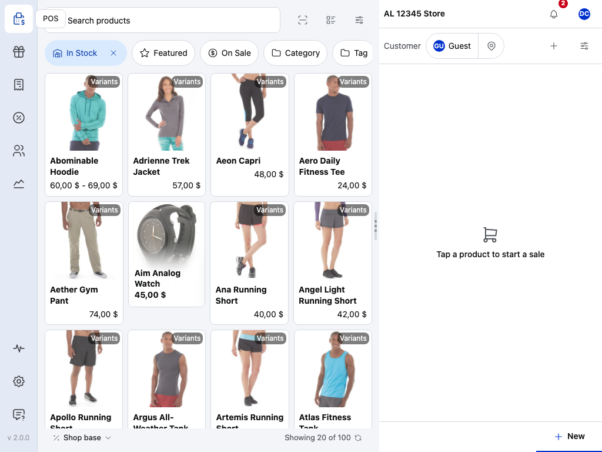
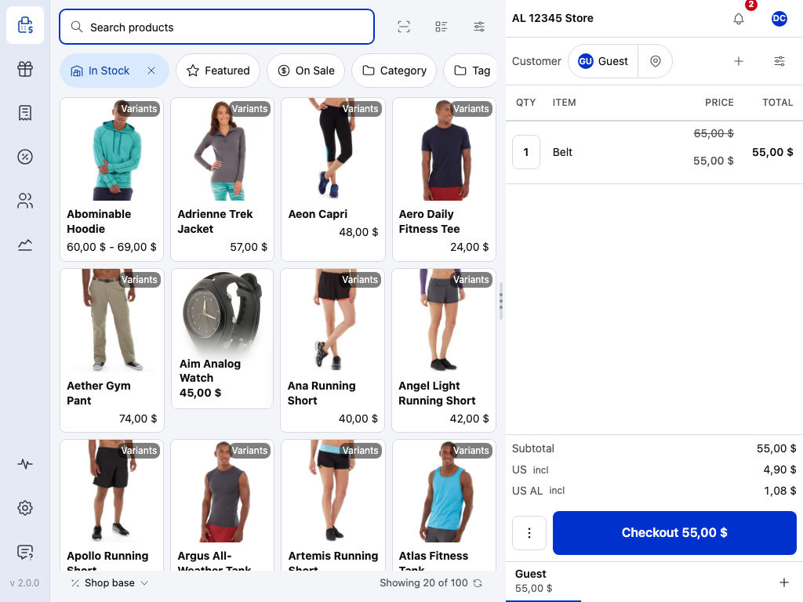
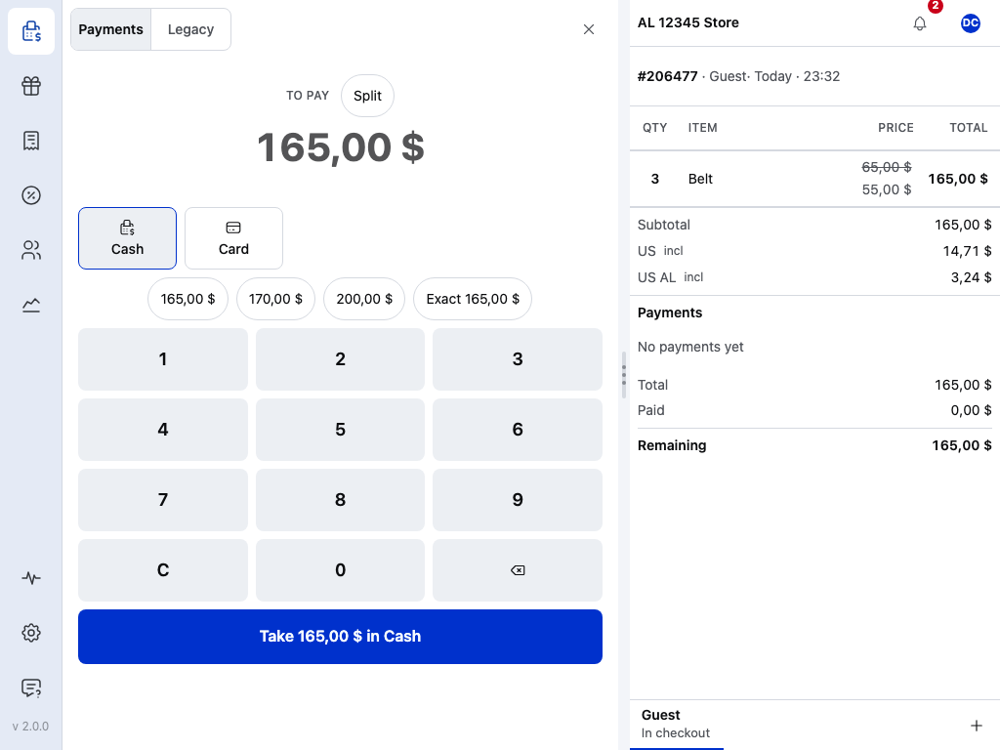
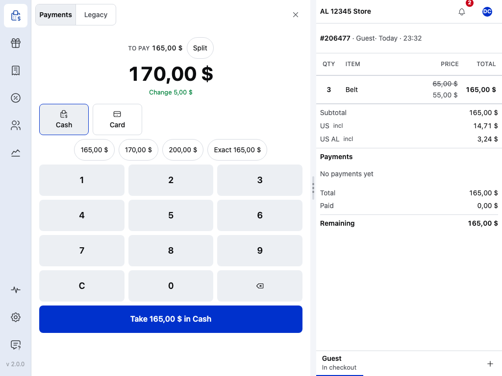
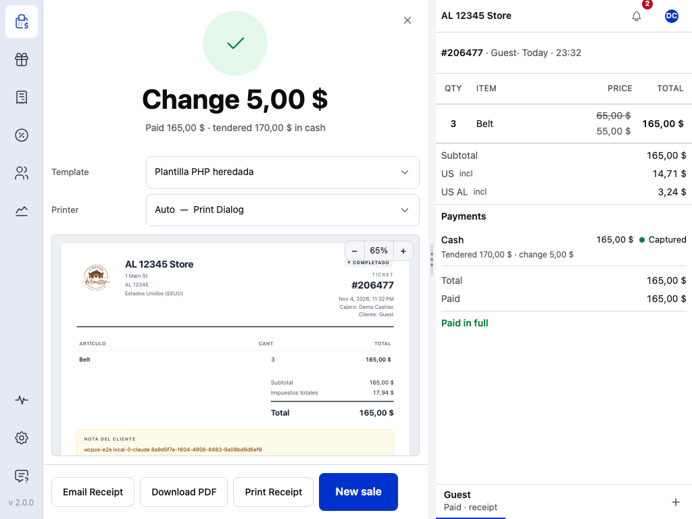

# WCPOS v2 parity audit: MedusaPOS

Read on 2026-11-10.
- **Target:** WCPOS 2.0.0, `~/Projects/monorepo` `main` at `5ac185b` (`apps/main` 2.0.0). Paths below are under `packages/core/src/` unless they start with `apps/` or `packages/`; `scr/` is `screens/main/`.
- **This app:** medusapos `main` at `8489e99`: app 0.2.0, plugin 0.3.0 (`packages/medusa-plugin`), `@tallyui/*` 3.8.0 pinned in `apps/expo/package.json`.

Each row is a feature a merchant expects, built Medusa's way (Paul, 2026-10-07): v2 sets which features and the taste, not the mechanism. `docs/V2-PARITY.md` stays the per-feature ledger with e2e evidence; this file is the v2 gap map and the work split.

**Status:** Has, Partial, Missing, N/A. **Gap owner:** **app** = `apps/expo` alone; **TU** = needs a shared TallyUI package, naming the package and the function; **plugin** = backend work in `packages/medusa-plugin`. **Build now** = app or plugin work that does not wait on TU.

## Areas

| # | v2 area (monorepo paths) | Status here | Evidence in this app | Gap and owner | Build now |
|---|---|---|---|---|---|
| 1 | Redrawn UI, Settings › Theme: 10 themes, **Scale** (Auto, Compact, Regular, Spacious), Icons, **Fonts** (System, DM Sans · Instrument Serif, Space Grotesk, DM Sans · Fraunces, Manrope) (`scr/settings/theme.tsx`, `contexts/scale`, `contexts/theme-setting`, `packages/components`) | Missing | Light only: `apps/expo/app/_layout.tsx` `Uniwind.setTheme('light')`; TU `theme` exports `cn` and `tokens.css` (has a `dark` variant) | **TU** `@tallyui/theme`: scale tokens + `ScaleProvider`, font families, theme presets; `@tallyui/components` redrawn kit. **app**: Settings › Theme section | System/Light/Dark switch on TU's dark tokens (U5) |
| 2 | Register screen layout: resizable columns, phone tabs, filter chips (`apps/main/app/(app)/(drawer)/(pos)`, `packages/resizable-panels`) | Partial | Fixed columns; phone below 600 px is Products → CartBar → Cart (`docs/adr/0009`) | **TU** `@tallyui/components`: resizable split, phone tab bar | — |
| 3 | Product browse: grid/table, variant drill-in, stock pill, "from" price, grid columns, tile fields, filter pills (`scr/pos/products`) | Partial | TU `Catalogue` grid/table + category nav (`apps/expo/lib/catalogue-view.ts`); variant chooser (ADR 0007) | **TU** `@tallyui/components` `Catalogue`: drill-in, stock pill, tile-field and column settings, tag/brand filter pills | — |
| 4 | Open orders as tabs (`scr/pos/cart/tabs.tsx`) | Missing | Parking only (TU `ParkedSales`) | **TU** `@tallyui/pos` `useSale` multi-order + `@tallyui/components` cart tabs | — |
| 5 | Cart editing: keypad qty, tap-to-edit, swipe, line sort (`scr/pos/cart/table.tsx`) | Partial | TU `Cart` qty, remove, `canEditPrice`, discount chips | **TU** `@tallyui/components` `Cart`: keypad, line sort setting | — |
| 6 | Add menu: misc product, fee, shipping, quick discount (`scr/pos/cart/add-*.tsx`) | Has | `order.create` v5 (`docs/adr/0021`), `e2e/charges.spec.ts`, `e2e/discount.spec.ts` | Quick-discount keys setting: **TU** | — |
| 7 | Coupons in cart (`scr/pos/cart/add-coupon*.tsx`) | Missing | `plan.ts` sends no promotion codes | **TU** coupon entry (TallyUI#500/#501); **plugin** apply Medusa promotion codes in `workflows/tally-order-create` | — (needs TU's payload) |
| 8 | Order sheet: note, meta, void, print, sync (`scr/pos/cart/order-sheet.tsx`) | Missing | TU `OrderBuilder.setNote` and `CartNoteInput` exist; `useSale` has no `setNote` (TallyUI#520); plugin drops the note | **TU** `@tallyui/pos` `useSale().setNote`; **plugin** map `order.note` in `tally-order-create/plan.ts`; **app** `CartNoteInput` | Plugin note mapping (U4) |
| 9 | Customer in cart: search, guest, create (`scr/pos/cart/add-customer.tsx`) | Has | TU `CustomerPicker`; `e2e/customers.spec.ts` | Default customer setting: **app** | — |
| 10 | Totals and tax display, itemized/single (`scr/pos/cart/totals.tsx`) | Has | `Cart` `taxLabel`; region tax-inclusive prices | — | — |
| 11 | Tender pane: tiles, keypad, quick amounts, split ledger, change, void legs, cash rounding (`scr/pos/checkout/tender`) | Partial | TU `Tender` / `SplitTender`, "Split payment" toggle; `e2e/split-tender.spec.ts`. No keypad pane or leg void; card is `external` only | **TU** `@tallyui/components` tender pane redraw, `@tallyui/pos` cash rounding | — |
| 12 | Offline cash sales and outbox (`scr/pos/checkout/commit-sale.ts`, `packages/sync-core`) | Has | `apps/expo/lib/outbox-context.tsx`, SQLite-wasm; `e2e/offline.spec.ts`, `e2e/outbox.spec.ts` | — | — |
| 13 | Receipt stage: print & new sale, no receipt, auto-print, drawer kick (`scr/pos/checkout/receipt-stage`) | Partial | TU `Receipt` + Print / New sale (`apps/expo/app/index.tsx`) | **TU** auto-show/auto-print settings, drawer kick (printing) | — |
| 14 | Registers: float, pay in/out with reasons, no sale (`scr/pos/cart/register-*.tsx`, `services/register`) | Has | `apps/expo/components/register.tsx`; `e2e/register.spec.ts` | No-sale: **TU** | — |
| 15 | Count at close, numbered closures, Z print, X report, handover (`services/register-session`, `scr/components/register-count`) | Partial | TU `RegisterCount`, `ClosureSheet` ("Closure #n"), `LastClosureSheet`; `ClosureSheet` `onPrint` not passed; no X report | **app** pass `onPrint` with `buildClosureDocument`; X report from `buildXReportDocument`; handover: **TU** | Z/X print (U1) |
| 16 | Manager approval over a threshold (`scr/pos/cart/approve-sheet.tsx`) | Partial | Plugin 0.3.0 verifies a proof (`POST /tally/v1/register-approvals`, contract 3, #254); the till still sends v2 commands with a second login (`apps/expo/lib/approval.ts`) | **TU** `@tallyui/pos` `register-commands`: a contract-3 `closure.submit` carrying `approval`; then **app** obtains the proof | — (needs TU) |
| 17 | Reports: sales cards, closures history with recount, CSV, print (`scr/reports`) | Missing | Register panel shows "n sales this session"; TU `pos` has `selectClosureRows`, `clampClosureScope`, `exportCsv`, `buildXReportDocument`, no screen | **app** `/reports` over local closures and outbox orders with TU helpers; **plugin** `GET /tally/v1/registers/:id/closures` for history beyond this till; **TU** `@tallyui/components` `ReportsScreen` cards if shared | Reports route (U2), closures route (U3) |
| 18 | Orders screen: list, view, reopen, receipt, refund (`scr/orders`) | Partial | `apps/expo/app/orders.tsx`: TU `OrdersList` of this till's outbox | **plugin** `GET /tally/v1/orders`; **TU** `@tallyui/connector-medusa` `listOrders` and the route contract (G7 b3); **app** wire TU `OrderList`/`OrderDetail` | — (contract is TU's) |
| 19 | Refunds: per line or amount, reason, destination (`scr/orders/refund`) | Missing | No refund command | **TU** `@tallyui/pos` refund model + `refund.create` command; **plugin** command on Medusa returns/refund workflows; **app** flow from an order | — |
| 20 | Receipts screen: templates, printer switch, email with offline queue (`scr/receipt`) | Partial | On-screen receipt, browser print. TU core `Connector.emailReceipt?(ctx, orderId, email, {saveToBilling})` exists; `connector-medusa` does not implement it | **plugin** `POST /tally/v1/orders/:id/receipt-email` through Medusa's notification module; **TU** `@tallyui/connector-medusa` `emailReceipt`, `@tallyui/components` `Receipt` email action + queue | Plugin email route (U6) |
| 21 | Receipt templates (15), ESC/POS, ePOS, raster (`packages/receipt-renderer`, `packages/printer`) | Missing | One layout | **TU** renderer + printer packages | — |
| 22 | Printing settings: printers, paper, codepage, drawer kick, routing (`scr/settings/printing`) | Missing | "Printer settings land here later (ADR 0016)" in `apps/expo/app/settings.tsx` | **TU** printer package + settings components | — |
| 23 | Card readers: Tap to Pay, Bluetooth, smart readers (`scr/settings/card-readers`, `services/terminal-payments`) | Missing | Card is an `external` payment | **TU** `@tallyui/pos` payment-transport interface; **plugin** route to the store's Medusa payment providers (Stripe Terminal) | — |
| 24 | Customer display: pairing, live mirror (`services/customer-display`) | Missing | — | **TU** display component + peer channel; **plugin** pairing endpoint | — |
| 25 | Barcode: wedge, HID, BLE, camera, sounds, test panel (`packages/scanner`, `scr/settings/barcode-scanning`) | Partial | Wedge + min length + test field (`apps/expo/lib/use-wedge-scan.ts`, `e2e/settings.spec.ts`) | **TU** scanner package (camera, sounds, prefix/suffix) | — |
| 26 | Sync: status dot, sync button, refusals (`packages/sync-engine`, `scr/components/online-status`) | Has | TU `SyncStatus`, `OutboxStrip`, live stock (`/tally/v1/changes`); `e2e/strips.spec.ts`, `e2e/live-stock.spec.ts` | — | — |
| 27 | Health: database, logs, performance (`scr/health`, `scr/logs`) | Missing | Console logging + Send feedback (`apps/expo/lib/logging.ts`) | **TU** `@tallyui/pos` ring-buffer log sink + `@tallyui/components` log view; **app** route | — |
| 28 | General settings: store info, language, number format, default customer, clear local data (`scr/settings/general.tsx`) | Partial | `apps/expo/app/settings.tsx`: Register (till name), Scanner; TU `SettingsLayout`/`SettingsGroup`/`SettingsRow` unused | **app** adopt `SettingsLayout`; Store (read-only Medusa store, region, location) and Danger zone sections | Settings redraw (U7) |
| 29 | Tax settings mirror (`scr/settings/tax.tsx`) | N/A | Woo setup mirror; Medusa's equivalent is the region's tax settings, shown read-only in Store (row 28) | — | in U7 |
| 30 | Products/stock/COGS editing (`scr/products`) | Missing | — | **TU** edit sheet + `connector-medusa` `updateVariantPrice`/`adjustStock`; **plugin** or admin API under RBAC | — |
| 31 | Customer management: add/edit, addresses (`scr/customers`) | Partial | Search, attach, create; no edit | **TU** `@tallyui/core` `Connector.updateCustomer` + Medusa connector; **app** screen | — |
| 32 | Coupons screen (`scr/coupons`) | N/A | Medusa Admin owns promotions | — | — |
| 33 | Cashier switching, switch register/store (`scr/pos/cart/user-sheet.tsx`) | Partial | Sign out; register picker; one admin login per till (`apps/expo/lib/session.ts`) | **TU** user sheet + cashier model | — |
| 34 | Multi-store (`use-switch-store.ts`) | Partial | Region and stock location per till, default sales channel only (`apps/expo/lib/store-settings.ts`) | **TU** `useStoreSettings` channel choice; **plugin** channel on `/info` and order create | — |
| 35 | Update/upgrade-required latch (`scr/update-required.tsx`) | Missing | No app/plugin version gate | **plugin** advertise contract versions on `/info` (exists for register); **TU** shared latch screen | — |
| 36 | One live tab (`packages/database/src/live-tab`) | Has | `e2e/live-tab.spec.ts` | — | — |
| 37 | Keyboard shortcuts and help sheet (`extensions/hotkeys`) | Missing | — | **TU** `@tallyui/pos` command registry + hotkeys | — |
| 38 | Translations (`contexts/translations`); no RTL in v2 either | Missing | English only | **TU** i18n in all components | — |
| 39 | Notifications bell (Novu), Pro gating, Support | N/A | WCPOS business infrastructure | — | — |

## Screenshots

v2 (WCPOS 2.0.0 checkout journey, tablet, light, regular scale; copied from the monorepo capture run `514-j2-capture-manifest`) against this app at 1280 × 800 on the e2e store:

| Step | v2 | MedusaPOS |
|---|---|---|
| Start a sale |  |  |
| Product in cart |  |  |
| Check out |  |  |
| Cash taken |  |  |
| Paid |  |  |

## Build now (app or plugin, no TU wait)

Top down by what a merchant sees. Each is one spec, one PR.

- **U1** Z and X print: pass `ClosureSheet` `onPrint`, add "Print X report" to the register panel (app).
- **U2** `/reports` route: today's sales on this register from the outbox, closures list via `selectClosureRows`, CSV via `exportCsv` (app).
- **U3** `GET /tally/v1/registers/:id/closures` with paging (plugin).
- **U4** Map `order.note` into the Medusa order in `tally-order-create` (plugin).
- **U5** Theme: System / Light / Dark setting on TU's dark tokens (app).
- **U6** `POST /tally/v1/orders/:id/receipt-email` through the notification module (plugin).
- **U7** Settings redraw on TU `SettingsLayout`, with Store and Danger zone sections (app).

## Needs from shared TallyUI packages

- `@tallyui/theme`: scale tokens + provider (Auto/Compact/Regular/Spacious), font families, theme presets.
- `@tallyui/pos` `register-commands`: contract-3 `closure.submit` with `approval`.
- `@tallyui/pos` `useSale().setNote` (TallyUI#520).
- `@tallyui/pos` `useSale` multi-order + `@tallyui/components` cart tabs.
- `@tallyui/connector-medusa` `listOrders` + the `/tally/v1/orders` contract; `emailReceipt`; `updateCustomer` (with `@tallyui/core` `Connector.updateCustomer`).
- `@tallyui/pos` refund model and `refund.create` command.
- `@tallyui/components` tender pane redraw (keypad, quick amounts, leg void), `ReportsScreen` cards, log view.
- `@tallyui/pos` payment-transport interface (card readers); customer display channel; printer/receipt-renderer; scanner (camera); hotkeys; i18n.
